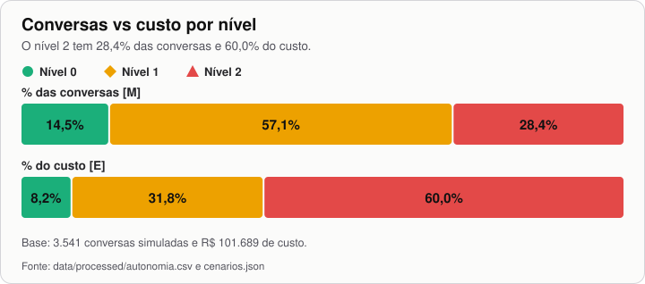
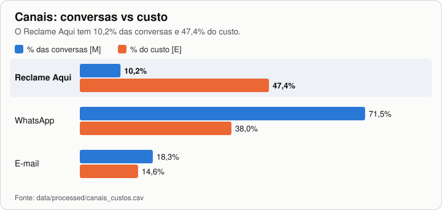
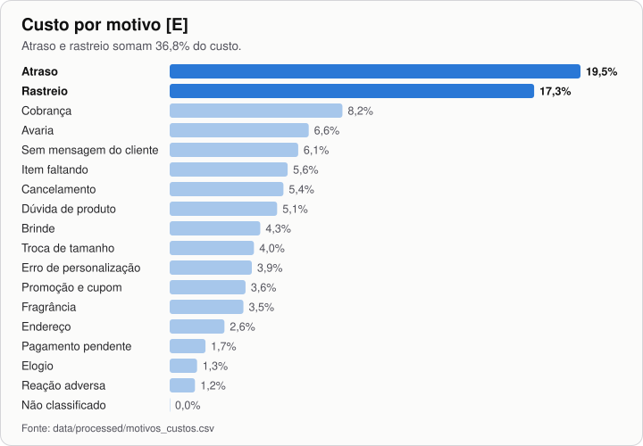
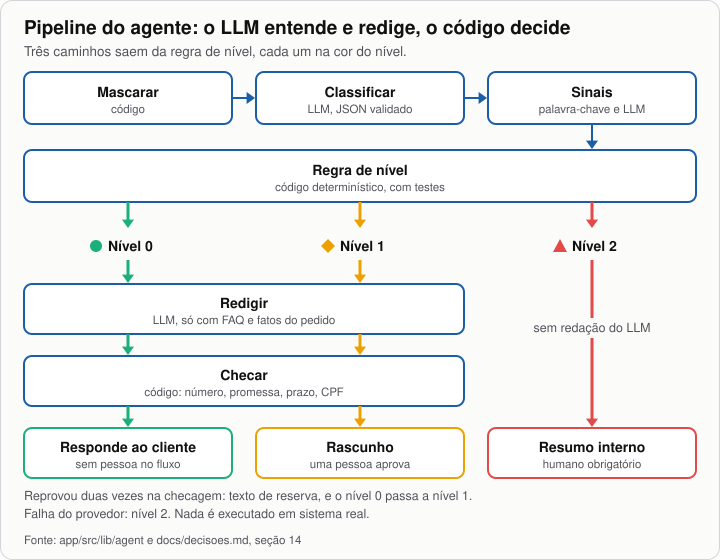
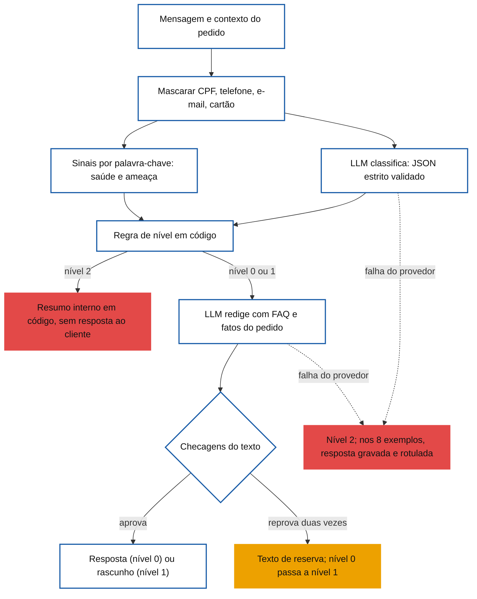
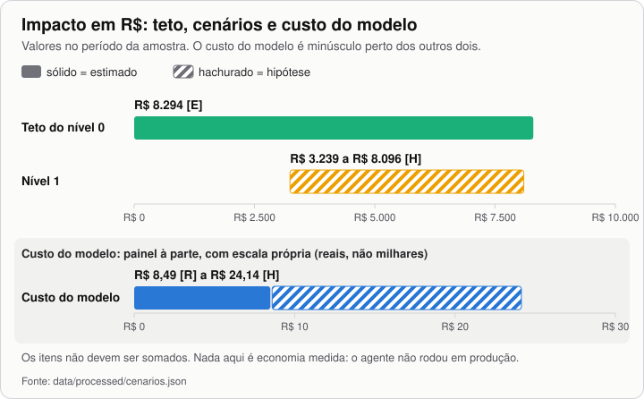

# Relatório de impacto e rigor: agente de atendimento Gocase e GoBeaute

## Em 30 segundos

- **O que é:** agente que classifica cada conversa de atendimento da Gocase e da GoBeaute e devolve uma ação com justificativa.
- **Princípio:** o modelo interpreta e escreve; nível e ação saem de regra em código.
- **Problema:** R$ 108.299 de custo [E]; Reclame Aqui com 10,2% das conversas [M] e 47,4% do custo [E].
- **Autonomia:** nível 0 em 14,5%, nível 1 em 57,1% e nível 2 em 28,4% das conversas simuladas [M].
- **Impacto, não medido em produção:** teto de R$ 8.294 no nível 0 [E]; R$ 3.239 a R$ 8.096 no nível 1 [H].
- **Segurança:** CPF, telefone, e-mail e cartão mascarados antes do modelo; saúde e ameaça só com humano; nada executa em sistema real.
- **Evidência:** 1.408 testes automatizados [R]; motivo igual ao rótulo em 91,0% de 78 conversas [M]; nível igual em 76 delas [M].
- **Limites:** dados sintéticos; 22 dos 78 rótulos revisados por pessoa [M]; simulação com classificador por regras.
- **Pedido:** piloto só de nível 0, em rastreio e pagamento pendente: 476 conversas (13,4%) [M], teto de R$ 7.668 [E].
- **Links:** [demo](https://gogroup-atendimento.vercel.app) · [repositório](https://github.com/MauroHLO/gogroup-atendimento) · [decisões](decisoes.md)



*Figura 1. Conversas vs custo por nível. Fonte: `data/processed/autonomia.csv`.*

> [!NOTE]
> **Como ler os números.** **[M]** medido na amostra (conversas de 1 em cada 3 clientes). **[E]** estimado para a população (amostra × 3; todo valor em R$ da análise). **[H]** hipótese. **[A]** associação, não causa. **[R]** registro do projeto: testes, telemetria, preço público, câmbio. O apêndice liga cada número à fonte, e `analysis/verificar_relatorio.py` confere cada linha.

## 1. Resumo executivo

**O custo está concentrado em poucos casos; o agente responde pouco sozinho, prepara o resto e deixa a decisão de risco com uma pessoa.**

| Impacto no período da amostra | O que é | Tipo |
|---|---|---|
| R$ 8.294 | teto do nível 0: todo o custo das conversas que ele responderia sozinho | [E] |
| R$ 3.239 a R$ 8.096 | nível 1, se preparar reduzir de 10% a 25% o tempo de tratamento | [H] |
| R$ 8,49 a R$ 24,14 | modelo, em 10.623 conversas; sem hospedagem, integração nem tempo de quem aprova | [R] com [H] |

> [!WARNING]
> Nada disso é economia medida: o agente não rodou em produção.

- **Fila:** 20,3% das conversas de WhatsApp com resposta do atendente passam do SLA [M]; preparar o caso pode reduzir o trabalho [H].
- **Fora do horário:** só o nível 0 responde na hora, em 14,5% das conversas simuladas [M].
- **Custo concentrado:** no Reclame Aqui, o nível 2 prioriza e resume, sem resposta automática em canal público.
- **Auditoria:** mesma entrada, mesma decisão, com 1.408 testes [R].

**Pedido:** piloto só com nível 0, em rastreio e pagamento pendente: 476 das 3.541 conversas simuladas (13,4%) [M], teto de R$ 7.668 [E]. Ele mede aprovação na revisão por amostragem, reprovação nas checagens, SLA e recontato.

## 2. O que os dados mostram

**O dinheiro está no Reclame Aqui (47,4% do custo [E]) e em atraso e rastreio (36,8% [E]), não no volume.** Base validada: 4.000 conversas, 14.559 mensagens, 3.237 pedidos, nenhuma duplicada [M] (≈ 12.000 conversas na população [E]).



*Figura 2. Conversas e custo por canal. Fonte: `data/processed/canais_custos.csv`.*



*Figura 3. Custo por motivo. Fonte: `data/processed/motivos_custos.csv`.*

| Achado | Número | Tipo | Por que importa |
|---|---|---|---|
| Custo de atendimento | R$ 108.299 | [E] | Base das contas de impacto. |
| Reclame Aqui | R$ 42,00 por conversa, contra R$ 4,80 no WhatsApp | [E] | Evitar a escalada pesa mais que automatizar volume. |
| Recontato | 36,1% no Reclame Aqui, 17,1% nos demais; R$ 28.343 no total | [M], [E] | O canal parece receber casos não resolvidos antes. |
| Atraso com pedido em trânsito | 72% | [M] | Aviso proativo é possível. |
| SLA no WhatsApp | 20,3% passam de 30 min (mediana 11,8 min) | [M] | A fila estoura mesmo em horário comercial. |
| Fora das 8h às 20h | 30,3% | [M] | Só o bot responde. |
| Rota Express | 62,8% dos contatos logísticos, 20,4% da referência (3,08×) | [A] | Onde investigar; não prova causa, e a base é aproximada. |

> [!NOTE]
> **Evitáveis [H].** 1.445 conversas (36,1%) são falha de processo; 1.496 (37,4%) caberiam em comunicação proativa ou autoatendimento [M para a contagem]. Dependem de corrigir a causa, então não viram reais.

## 3. A decisão de autonomia e por quê

**O agente executa sozinho só 8,2% do custo, de propósito; o valor está em preparar o nível 1 (31,8%) e priorizar o nível 2 (60,0%).**

| Nível | O que o agente faz | Motivos típicos | Conversas [M] | % conversas [M] | % custo [E] |
|---|---|---|---|---|---|
| 🟢 Nível 0 | responde só com fatos do pedido e FAQ | rastreio em trânsito, pagamento pendente, elogio | 514 | 14,5% | 8,2% |
| 🟡 Nível 1 | prepara ação e rascunho; pessoa aprova | atraso, avaria, item faltando, cancelamento, troca | 2.023 | 57,1% | 31,8% |
| 🔴 Nível 2 | só resume; humano obrigatório | reação adversa, cobrança, saúde, ameaça | 1.004 | 28,4% | 60,0% |

*Base: R$ 101.689 [E], as 3.541 conversas com mensagem do cliente. Fora: 459 conversas só com o bot (R$ 6.610 [E]). Sobre os R$ 108.299, o nível 0 é 7,7%.*

**Escalonadores (só sobem):** Reclame Aqui → nível 2; 2º contato → pelo menos nível 1; 3º contato → nível 2; pedido acima de R$ 200 → pelo menos nível 1; saúde ou ameaça → nível 2; confiança abaixo de 0,7 → sobe um nível; várias intenções → a mais restritiva.

| Escolha | O que evita |
|---|---|
| Reação adversa sempre em 🔴 Nível 2 | Resposta automática em saúde. Nas 40 conversas do tipo [M], o atendente ofereceu troca em todas e nenhuma cita registro ou lote. |
| Reclame Aqui em 🔴 Nível 2 | Resposta automática em canal público. |
| Reembolso, troca e cancelamento em 🟡 Nível 1 | Decidir sem foto, data de recebimento ou pagamento. |
| Cobrança em 🔴 Nível 2 | Afirmar algo sobre dinheiro sem dados. |
| Dúvida de produto e cupom em 🟡 Nível 1 | Inventar regra: essa FAQ está pendente. |
| Nível calculado em código | Mensagem convencer o modelo a subir a autonomia. |

## 4. Como funciona e por que assim

**O LLM entende e redige; o código decide.** O modelo erra e pode ser manipulado, então nunca escolhe nível nem ação.



*Figura 4. Pipeline com os três caminhos de nível. Fonte: `app/src/lib/agent` e `docs/decisoes.md`, seção 14.*

<details><summary>Fluxo detalhado, com reprovação e falha do provedor</summary>



</details>

| Camada | Risco que cobre |
|---|---|
| Mascaramento | Dado pessoal no provedor. De 5.684 mensagens de clientes, 174 têm CPF, 91 telefone e 45 cartão [M]. |
| JSON estrito | `nivel` inventado é descartado. Inválida após nova tentativa: confiança 0, nível 2. |
| Palavra-chave | Modelo deixar passar saúde ou ameaça: o sinal final é "ou" entre os dois. |
| Regra de nível | Decisão não auditável ou influenciada por injeção. |
| Checagens | Número sem fonte, promessa, ação narrada como feita, solução ou prazo fora da FAQ, pedido de CPF. |
| Texto de reserva | Reprovação sem saída: texto fixo, e o nível 0 passa a nível 1. |
| Contingência | Queda do provedor na demo: decisão recalculada, tela avisa que é gravada. Mensagens livres não têm. |

## 5. O que o agente NÃO faz

**O que exige fato que ele não tem, ou em que errar custa mais que esperar, fica fora.**

| Não faz | Por quê |
|---|---|
| Reembolso, estorno ou troca sozinho | Faltam foto, data de recebimento e pagamento. |
| Citar prazo fora da FAQ | Vira promessa; a checagem reprova. |
| Prometer contato no nível 0 | Não há pessoa no fluxo; a checagem reprova. |
| Responder a saúde ou ameaça | Nível 2, só com resumo interno. |
| Pedir CPF, cartão ou senha | A checagem reprova qualquer menção. |
| Executar em sistemas reais | Sem integração: "executa" é a ação sugerida. |

## 6. Testes e o que revelaram

**Os testes acharam defeitos reais, corrigidos com medida de antes e depois; a avaliação é boa, mas pequena.**

- **Automatizados:** 1.408 [R], sem chamar o modelo, incluindo os números do painel contra `data/processed/`.
- **Bateria ao vivo de 22 cenários [R]:** achou os defeitos 3 e 4.
- **Regressão final, 01/11/2026 [R]:** 15 mensagens fictícias digitadas por uma IA no navegador, revisadas por Mauro: exemplos prontos 1, 4, 5, 7 e 8, mais 10 livres. Nível esperado em todas. CPF e e-mail chegaram mascarados, e a instrução embutida não alterou a resposta. Os exemplos 2, 3 e 6 passaram em baterias anteriores.

**Avaliação do classificador** ([`decisoes.md`](decisoes.md), seção 16), 78 conversas, 6 por tag do agente:

| Medida | Resultado [M] |
|---|---|
| Motivo principal igual ao rótulo de leitura | 91,0% (IC 95%: 82,6 a 95,6); regras: 85,9% |
| Nível final igual | 76 de 78 |
| Abaixo do correto | 1 (pedido parado em trânsito) |
| Acima do correto | 1 (pergunta sobre devolução) |
| Saúde, por texto: modelo sozinho e pipeline | 96,2% e 100% (53 textos) |
| Ameaça | modelo 0 de 1 texto; pipeline 1 de 1 (161 mensagens): só o código pega |
| Revisão humana dos rótulos | parcial: 22 dos 78 (28,2%); 56 sem revisão de pessoa |

> [!WARNING]
> A revisão humana viu rótulo e previsão: é confirmação, não rotulagem independente. O conjunto de saúde veio de regex, então o recall tende a estar superestimado.

<details><summary>Defeitos encontrados e corrigidos</summary>

| # | Defeito | Antes | Depois | Commit |
|---|---|---|---|---|
| 1 | Ação narrada como feita | rascunhos de nível 1 diziam que a transportadora já tinha sido acionada, antes da aprovação | falha `acao_feita`; regravação sem o problema | `a056067` |
| 2 | Promessa de contato no nível 0 | o prompt pedia para dizer que a equipe analisa, sem pessoa no fluxo | falha `promessa_contato`; 8 de 8 exemplos sem fallback | `c429dcd` |
| 3 | "Reposição sem custo" | a checagem aprovava um desfecho que a FAQ usada não trazia | `termo_de_solucao`: o termo só passa se estiver na FAQ usada | `553787e` |
| 4 | Desculpas de atraso em outros motivos | em 22 cenários ao vivo, o exemplo do prompt vazava para outros rascunhos | assunto definido em código, sem exemplo no prompt | `a0f1901` |
| 5 | Regex de saúde com "Fórmula" | 9 textos com a palavra só no nome do produto iam ao nível 2 | 0; os 53 textos reais seguem em nível 2 (mesmo conjunto, não independente) | `397db9b` |
| 6 | "gravida" casava "gravidade" | sinal de saúde falso | palavra inteira, com testes; colisões semelhantes corrigidas em `8710d9e` | `85b2799` |
| 7 | Valor do pedido na resposta | a resposta de rastreio citava o valor | o valor saiu da redação; citá-lo reprova | `66ec350` |
| 8 | Ressalva temporal | "não é possível agora" sugeria que depois seria | só passa se estiver na FAQ usada; uma nova redação antes do texto de reserva | `4a0df94` |

</details>

## 7. Impacto em reais: teto, cenários e hipóteses

**São ordens de grandeza, e o custo do modelo não é o custo total do agente.** Período da amostra, sem extrapolação; os itens não se somam.



*Figura 5. Impacto em R$ (sólido = estimado; hachurado = hipótese). Fonte: `data/processed/cenarios.json`.*

**(a) Teto do nível 0: R$ 8.294 [E].** 8,2% do custo simulado (R$ 101.689) e 7,7% do total; os motivos do piloto são R$ 7.668 [E], ou 92,4% do teto.

> [!NOTE]
> Supõe que todo o custo dessas conversas sumiria, mas o custo é por canal e não distingue bot de atendente. Pode subir com a FAQ de produto validada.

**(b) Nível 1: cenários sobre R$ 32.386 [E].** Cada ponto percentual vale R$ 324.

| Cenário | Redução do tempo [H] | Valor [H] | % do custo total [H] |
|---|---|---|---|
| Conservador | 10% | R$ 3.239 | 3,0% |
| Base | 25% | R$ 8.096 | 7,5% |

> [!WARNING]
> **O percentual é hipótese, não dado.** Nada mede tempo de tratamento, a conta supõe custo proporcional ao tempo, e 10% e 25% foram escolhidos por nós. A segunda onda (seção 9) mede isso.

**(c) Custo do agente, só o modelo.**

| Item | Valor | Fonte |
|---|---|---|
| Tokens por classificação (médias) | 1.003 de entrada, 85,2 de saída [R] | `npm run smoke`, 5 chamadas, em 01/11/2026 |
| Tokens por redação (médias) | 608 de entrada, 64,5 de saída [R] | idem, 4 chamadas |
| Preço de `openai/gpt-oss-20b` | US$ 0,075 e US$ 0,30 por milhão [R] | [documentação da Groq](https://console.groq.com/docs/models), consulta em 01/11/2026 |
| Câmbio | R$ 5,4212 por dólar [R] | [PTAX de venda de 30/10/2026, Banco Central](https://olinda.bcb.gov.br/olinda/servico/PTAX/versao/v1/odata/) |
| **Caso base:** 10.623 conversas [E] | **R$ 8,49**, ou R$ 0,80 por mil | calculado |
| **Caso pessimista:** preço maior e o dobro de chamadas [H] | **R$ 24,14**, ou R$ 2,27 por mil; 0,022% do custo total | calculado |

> [!NOTE]
> **Preço.** [groq.com/pricing](https://groq.com/pricing) não abriu na consulta automatizada; confira no navegador. O [pricingsaas.com](https://pricingsaas.com/companies/groq/diffs/2025Q4) registra US$ 0,10 e US$ 0,50 até out/2025, depois os valores acima, com captura recente de US$ 0,08 na entrada [R]. Os antigos limitam o caso pessimista.
>
> **Fora da conta:** hospedagem, integração, monitoramento e tempo de quem aprova, que devem ser os custos relevantes. Medido em 5 mensagens fictícias.

## 8. Riscos e limites

**Os números servem para decidir um piloto, não para prever resultado em produção.**

| Limite | Efeito |
|---|---|
| Dados sintéticos e repetitivos | Texto real pode render menos. |
| Amostra pequena | 78 conversas, de 1 a 15 por motivo: sem conclusão por motivo. |
| Gabarito por IA | 22 de 78 revisados, sem independência total. |
| Tag do agente ruidosa | 36% das tags (26 de 72) não batem com o texto; medir contra ela não mede qualidade. |
| Simulação por regras | Concordância de 85,9%, sem `duvida_politica` e `direitos_titular`; regras escritas olhando estes dados. |
| Pedido parado em trânsito | Subescalada conhecida, sem correção ainda. |
| Saúde montada por regex | Não mede o que o regex não encontra. |
| Limites de requisição em memória | Por instância; produção pede contador compartilhado. |
| FAQ de produto pendente | Essas conversas ficam no nível 1. |
| Sem motivo de troca por insatisfação | Cai em `troca_tamanho` ou `cancelamento`. |
| Custo por canal | Não distingue bot de humano: nenhum valor em R$ prova economia. |

## 9. Próximos passos

**Começar pequeno, medir e só então ampliar.**

1. **Piloto só com nível 0:** rastreio em trânsito (435 conversas) e pagamento pendente (41) [M], sem escalonadores, com revisão humana por amostragem.
2. **Métricas:** aprovação humana, reprovação nas checagens, SLA e recontato, com limiares definidos antes com a operação.
3. **Ondas:** nível 0; nível 1 com aprovação, medindo o tempo; depois ampliar a FAQ.
4. **Pedido parado em trânsito:** regra em código, validada em amostra nova.
5. **Troca por insatisfação:** motivo novo, validado em amostra nova.
6. **Gabarito:** revisar os 56 rótulos restantes e, de preferência, rotular de forma independente.

## 10. Como o trabalho foi conduzido (AI-First)

**A IA escreveu e testou; a pessoa decidiu e revisou.**

- **Delegado à IA (assistente e Claude Code):** planejamento em conversa, código e testes, análise, rótulos iniciais, rascunhos e testes ao vivo.
- **Com a pessoa:** decisões de autonomia, aprovação das correções e revisão do gabarito e dos testes ao vivo.
- **Controle:** regra alterada vem com teste e registro em `decisoes.md`; correção vem com medida de antes e depois.

## Apêndice

### Como reproduzir

Os dados brutos (`data/raw/`) e os da avaliação (`data/interim/`) ficam fora do Git.

```bash
python analysis/analise_atendimento.py               # agregados da análise
python analysis/avaliacao_classificador.py metricas  # agregados da avaliação
python analysis/cenarios_impacto.py                  # cenarios.json
python analysis/graficos.py                          # figuras de docs/img/
python analysis/verificar_relatorio.py               # confere este relatório
cd app && npm test && npx tsc --noEmit && npm run lint && npm run build
npm run smoke                                        # chama o Groq; precisa de app/.env.local
```

### Mapa de arquivos

| Caminho | Conteúdo |
|---|---|
| `analysis/` | análise, avaliação, cenários, figuras e verificação do relatório |
| `data/processed/` | agregados, sem texto de mensagem |
| `app/src/lib/` | `pii`, `policy`, `acoes`, `faq`, `agent`, `limites`, `rota`, `impacto` |
| `docs/decisoes.md` | decisões, com a avaliação na seção 16 |

### Número → fonte

Arquivos sem caminho estão em `data/processed/`. `doc:` = conferido no documento citado; `vitest` = na execução dos testes.

<details><summary>Abrir a tabela completa</summary>

| Número | Fonte | Tipo |
|---|---|---|
| 108.299 | `metricas.json#resumo.custo_estimado_populacao_rs` | E |
| 10,2 | `canais_custos.csv#reclame_aqui.pct_conversas` | M |
| 47,4 | `canais_custos.csv#reclame_aqui.pct_custo` | E |
| 36,8 | `cenarios.json#derivados.atraso_mais_rastreio_pct` | E |
| 19,5 | `motivos_custos.csv#atraso.pct_custo` | E |
| 17,3 | `motivos_custos.csv#rastreio.pct_custo` | E |
| 30,3 | `metricas.json#pct_abertas_fora_do_horario` | M |
| 8.294 | `cenarios.json#teto_nivel_0.rs` | E |
| 3.239 | `cenarios.json#nivel_1.cenarios.conservador.rs` | H |
| 8.096 | `cenarios.json#nivel_1.cenarios.base.rs` | H |
| 10 | `cenarios.json#nivel_1.cenarios.conservador.reducao_pct` | H |
| 25 | `cenarios.json#nivel_1.cenarios.base.reducao_pct` | H |
| 8,49 | `cenarios.json#custo_do_agente.base.total_rs` | R |
| 24,14 | `cenarios.json#custo_do_agente.pessimista.total_rs` | H |
| 10.623 | `cenarios.json#base_de_custo.conversas_simuladas_populacao` | E |
| 476 | `cenarios.json#piloto.conversas_amostra` | M |
| 3.541 | `metricas.json#resumo.conversas_com_mensagem_do_cliente` | M |
| 13,4 | `cenarios.json#piloto.pct_das_simuladas` | M |
| 78 | `avaliacao_classificador.json#revisao_humana.rotulos_da_amostra` | M |
| 22 | `avaliacao_classificador.json#revisao_humana.rotulos_da_amostra_revisados` | M |
| 22 | `doc:docs/decisoes.md` | R |
| 4.000 | `metricas.json#validacao.conversas` | M |
| 14.559 | `metricas.json#validacao.mensagens` | M |
| 3.237 | `metricas.json#validacao.pedidos` | M |
| 12.000 | `metricas.json#resumo.conversas_estimadas_populacao` | E |
| 42,00 | `cenarios.json#custo_por_conversa_rs.reclame_aqui` | E |
| 4,80 | `cenarios.json#custo_por_conversa_rs.whatsapp` | E |
| 36,1 | `metricas.json#recontato_escalada.pct_ra_recontato` | M |
| 36,1 | `cenarios.json#derivados.falha_processo_pct` | M |
| 17,1 | `metricas.json#recontato_escalada.pct_demais_recontato` | M |
| 28.343 | `metricas.json#recontato_escalada.custo_recontato_rs` | E |
| 72 | `metricas.json#pct_atraso_com_status_em_transito` | M |
| 20,3 | `sla.csv#whatsapp.pct_estouro_sla` | M |
| 30 | `doc:README.md` | R |
| 11,8 | `sla.csv#whatsapp.mediana_min` | M |
| 62,8 | `transportadoras.csv#Rota Express.pct_nos_contatos_logisticos` | A |
| 20,4 | `transportadoras.csv#Rota Express.pct_na_referencia` | A |
| 3,08 | `transportadoras.csv#Rota Express.razao` | A |
| 1.445 | `grupos_evitaveis.csv#falha_de_processo.conversas` | M |
| 1.496 | `grupos_evitaveis.csv#comunicacao_proativa_ou_autoatendimento.conversas` | M |
| 37,4 | `cenarios.json#derivados.proativa_pct` | M |
| 514 | `autonomia.csv#0.conversas` | M |
| 2.023 | `autonomia.csv#1.conversas` | M |
| 1.004 | `autonomia.csv#2.conversas` | M |
| 14,5 | `autonomia.csv#0.pct_conversas` | M |
| 57,1 | `autonomia.csv#1.pct_conversas` | M |
| 28,4 | `autonomia.csv#2.pct_conversas` | M |
| 8,2 | `autonomia.csv#0.pct_custo` | E |
| 31,8 | `autonomia.csv#1.pct_custo` | E |
| 60,0 | `autonomia.csv#2.pct_custo` | E |
| 200 | `doc:README.md` | R |
| 0,7 | `doc:README.md` | R |
| 101.689 | `cenarios.json#base_de_custo.custo_simulado_rs` | E |
| 459 | `metricas.json#resumo.conversas_so_bot` | M |
| 6.610 | `cenarios.json#base_de_custo.custo_so_bot_rs` | E |
| 7,7 | `cenarios.json#teto_nivel_0.pct_do_custo_total` | E |
| 40 | `metricas.json#reacao_adversa.conversas` | M |
| 5.684 | `metricas.json#pii_nas_mensagens.msgs_cliente` | M |
| 174 | `metricas.json#pii_nas_mensagens.com_cpf` | M |
| 91 | `metricas.json#pii_nas_mensagens.com_telefone` | M |
| 45 | `metricas.json#pii_nas_mensagens.com_cartao` | M |
| 8 | `doc:README.md` | R |
| 1.408 | `vitest` | R |
| 91,0 | `avaliacao_classificador.json#contra_rotulo_de_leitura.llm_principal.pct` | M |
| 82,6 | `avaliacao_classificador.json#contra_rotulo_de_leitura.llm_principal.ic95_inf` | M |
| 95,6 | `avaliacao_classificador.json#contra_rotulo_de_leitura.llm_principal.ic95_sup` | M |
| 85,9 | `avaliacao_classificador.json#contra_rotulo_de_leitura.regras_principal.pct` | M |
| 76 | `avaliacao_classificador.json#nivel.igual` | M |
| 1 | `avaliacao_classificador.json#nivel.abaixo_do_correto` | M |
| 1 | `avaliacao_classificador.json#nivel.acima_do_correto` | M |
| 96,2 | `avaliacao_classificador.json#sinais.saude_leitura.modelo.textos_unicos.pct` | M |
| 100 | `avaliacao_classificador.json#sinais.saude_leitura.final_pipeline.textos_unicos.pct` | M |
| 53 | `avaliacao_classificador.json#sinais.saude_leitura.modelo.textos_unicos.n` | M |
| 0 | `avaliacao_classificador.json#sinais.ameaca_regex_python.modelo.textos_unicos.acertos` | M |
| 1 | `avaliacao_classificador.json#sinais.ameaca_regex_python.final_pipeline.textos_unicos.acertos` | M |
| 161 | `avaliacao_classificador.json#sinais.ameaca_regex_python.final_pipeline.mensagens.acertos` | M |
| 28,2 | `cenarios.json#derivados.rotulos_revisados_pct` | M |
| 56 | `avaliacao_classificador.json#revisao_humana.rotulos_da_amostra_nao_revisados` | M |
| 9 | `avaliacao_classificador.json#sinais.saude_falso_positivo_do_regex.textos` | M |
| 0 | `avaliacao_classificador.json#sinais.saude_falso_positivo_do_regex.final_marcou_saude` | M |
| 32.386 | `autonomia.csv#1.custo_rs` | E |
| 324 | `cenarios.json#nivel_1.rs_por_ponto_percentual` | H |
| 3,0 | `cenarios.json#nivel_1.cenarios.conservador.pct_do_custo_total` | H |
| 7,5 | `cenarios.json#nivel_1.cenarios.base.pct_do_custo_total` | H |
| 1.003 | `cenarios.json#custo_do_agente.tokens.classificacao.prompt_medio` | R |
| 85,2 | `cenarios.json#custo_do_agente.tokens.classificacao.completion_medio` | R |
| 5 | `cenarios.json#custo_do_agente.tokens.classificacao.chamadas_medidas` | R |
| 608 | `cenarios.json#custo_do_agente.tokens.redacao.prompt_medio` | R |
| 64,5 | `cenarios.json#custo_do_agente.tokens.redacao.completion_medio` | R |
| 4 | `cenarios.json#custo_do_agente.tokens.redacao.chamadas_medidas` | R |
| 0,075 | `cenarios.json#custo_do_agente.preco.documentacao.entrada` | R |
| 0,30 | `cenarios.json#custo_do_agente.preco.documentacao.saida` | R |
| 0,10 | `cenarios.json#custo_do_agente.preco.referencia_alta.entrada` | R |
| 0,50 | `cenarios.json#custo_do_agente.preco.referencia_alta.saida` | R |
| 5,4212 | `cenarios.json#custo_do_agente.cambio.rs_por_usd` | R |
| 0,80 | `cenarios.json#custo_do_agente.base.rs_por_mil_conversas` | R |
| 2,27 | `cenarios.json#custo_do_agente.pessimista.rs_por_mil_conversas` | H |
| 0,022 | `cenarios.json#custo_do_agente.pct_do_custo_total_pessimista` | H |
| 36 | `cenarios.json#derivados.tag_ruidosa_pct` | M |
| 26 | `avaliacao_classificador.json#contra_tag.tag_questionavel` | M |
| 72 | `avaliacao_classificador.json#contra_tag.n` | M |
| 15 | `doc:docs/decisoes.md` | M |
| 6 | `avaliacao_classificador.json#por_estrato` | M |
| 435 | `cenarios.json#piloto.rastreio` | M |
| 41 | `cenarios.json#piloto.pagamento_pendente` | M |
| 7.668 | `cenarios.json#piloto.teto_rs` | E |
| 92,4 | `cenarios.json#piloto.pct_do_teto_nivel_0` | E |
| 0,08 | `cenarios.json#custo_do_agente.preco.captura_recente.entrada` | R |
| 15 | `doc:docs/decisoes.md` | R |
| 10 | `doc:docs/decisoes.md` | R |

</details>
