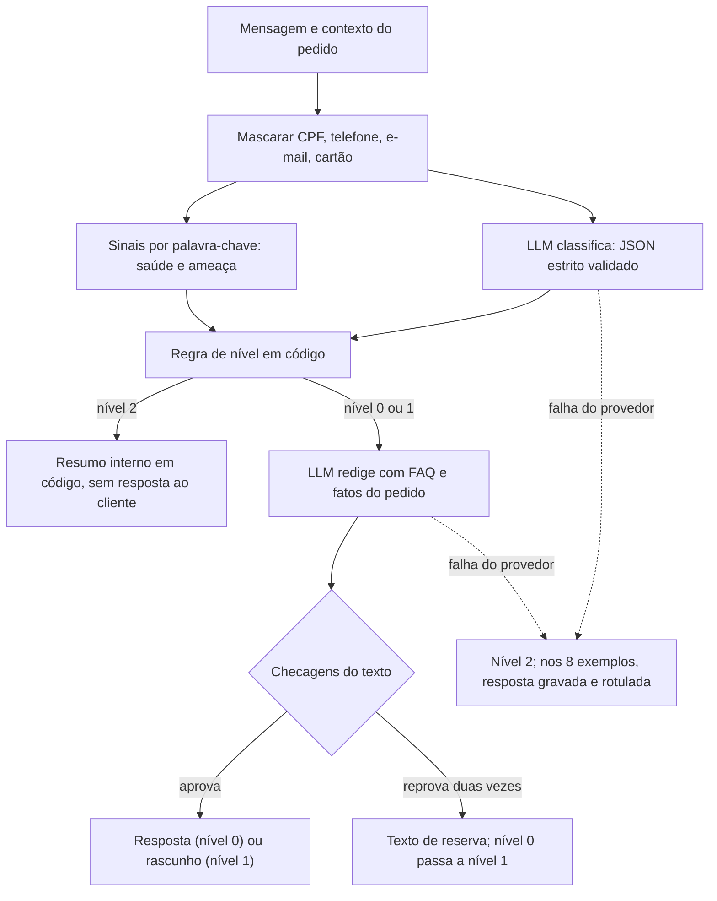

# Relatório de impacto e rigor: agente de atendimento Gocase e GoBeauté

Desafio AI-First do GoGroup, Problema 1. Demo pública: https://gogroup-atendimento.vercel.app. Decisões completas: [`decisoes.md`](decisoes.md).

**Como ler os números.** Cada número traz o tipo. **[M]** medido na amostra (conversas de 1 em cada 3 clientes). **[E]** estimado para a população (amostra × 3; todo valor em R$ da análise). **[H]** hipótese. **[A]** associação, não causa. **[R]** registro do projeto: testes, telemetria, preço público, câmbio. A tabela "número → fonte" está no apêndice, e `analysis/verificar_relatorio.py` confere cada linha contra os arquivos.

## 1. Resumo executivo

**Problema.** O atendimento custa R$ 108.299 [E] no período da amostra. O Reclame Aqui tem 10,2% das conversas [M] e 47,4% do custo [E]. Atraso e rastreio somam 36,8% do custo [E]. E 30,3% das conversas abrem fora das 8h às 20h [M].

**Solução.** Um agente que lê a mensagem, identifica o motivo e, por regra em código, escolhe um de três caminhos: responde sozinho (nível 0), prepara a ação para uma pessoa aprovar (nível 1) ou passa o caso a um humano com um resumo (nível 2). O modelo de linguagem entende e redige; o código decide.

**Três números de impacto, no período da amostra:**

| Número | O que é | Tipo |
|---|---|---|
| R$ 8.294 | teto do nível 0, nesta simulação: todo o custo das conversas que o agente poderia responder sozinho | [E] |
| R$ 3.239 a R$ 8.096 | cenários para o nível 1, se a preparação reduzir de 10% a 25% o tempo de tratamento | [H] |
| R$ 8,49 a R$ 24,14 | custo de modelo para processar as 10.623 conversas com mensagem do cliente; não inclui hospedagem, integração nem o tempo de quem aprova | [R] com [H] |

Nada disso é economia medida: o agente não rodou em produção.

**O que se pede à empresa.** Um piloto só com nível 0, em rastreio e pagamento pendente. Esses dois motivos são 476 das 3.541 conversas simuladas (13,4%) [M]. O piloto mede o que este relatório só pode supor: aprovação na revisão por amostragem, reprovação nas checagens, SLA e recontato.

**Principais limites.** Dados sintéticos. Amostra de avaliação pequena (78 conversas), com rótulos feitos por IA e revisão humana parcial (22 dos 78). Simulação feita com o classificador por regras, não com o modelo do agente. Detalhes na seção 8.

## 2. O que os dados mostram

Base validada: 4.000 conversas, 14.559 mensagens, 3.237 pedidos, nenhuma duplicada [M] (≈ 12.000 conversas na população [E]).

| Achado | Número | Tipo | Por que importa para a operação |
|---|---|---|---|
| Custo de atendimento | R$ 108.299 | [E] | É a base de toda conta de impacto. |
| Reclame Aqui | 47,4% do custo, 10,2% das conversas | [E], [M] | Cada conversa custa R$ 42,00, contra R$ 4,80 no WhatsApp [E]. Evitar a escalada pesa mais que automatizar volume. |
| Recontato | 36,1% no Reclame Aqui, 17,1% nos demais canais; R$ 28.343 no total | [M], [E] | O Reclame Aqui tende a ser fim de escalada. O recontato é o custo de não resolver antes. |
| Atraso e rastreio | 19,5% + 17,3% = 36,8% do custo | [E] | Maior grupo de custo, e parte dele é informação que o cliente poderia receber sem perguntar. |
| Atraso com pedido em trânsito | 72% | [M] | O aviso proativo é possível: o pedido ainda está em movimento quando a queixa chega. |
| SLA no WhatsApp | 20,3% passam de 30 min (mediana 11,8 min) | [M] | A fila estoura mesmo no horário comercial. Preparar o caso reduz o trabalho de cada atendimento. |
| Fora do horário | 30,3% | [M] | Nessas horas só o bot responde, e é onde a resposta factual do nível 0 mais ajuda. |
| Rota Express | 62,8% dos contatos logísticos, 20,4% da referência (3,08×) | [A] | Indica onde investigar a transportadora. Não prova causa, e a base de comparação é aproximada. |

**Contatos potencialmente evitáveis [H].** 1.445 conversas (36,1%) são falha de processo, e 1.496 (37,4%) caberiam em comunicação proativa ou autoatendimento [M para a contagem]. Evitá-las depende de corrigir a causa, não só do agente; por isso o relatório não as converte em reais.

## 3. A decisão de autonomia e por quê

| Nível | O que o agente faz | Motivos típicos | Conversas [M] | % conversas [M] | % custo [E] |
|---|---|---|---|---|---|
| 0 | responde só com fatos do pedido e FAQ | rastreio em trânsito, pagamento pendente, elogio | 514 | 14,5% | 8,2% |
| 1 | prepara ação e rascunho; pessoa aprova | atraso, avaria, item faltando, cancelamento, troca | 2.023 | 57,1% | 31,8% |
| 2 | só resume; humano obrigatório | reação adversa, cobrança, saúde, ameaça | 1.004 | 28,4% | 60,0% |

**Escalonadores (só sobem o nível):** Reclame Aqui → nível 2; 2º contato → pelo menos nível 1; 3º contato → nível 2; pedido acima de R$ 200 → pelo menos nível 1; saúde ou ameaça → nível 2; confiança abaixo de 0,7 → sobe um nível; várias intenções → vale a mais restritiva.

**Mensagem-chave.** O agente executa sozinho pouco do custo (8,2%), de propósito. O valor está em preparar o nível 1 (31,8%) e priorizar o nível 2 (60,0%), sem tirar a pessoa das decisões que têm risco.

Base dos percentuais: R$ 101.689 [E], as 3.541 conversas com mensagem do cliente. As 459 conversas só com o bot (R$ 6.610 [E]) ficam fora. Sobre os R$ 108.299, o nível 0 é 7,7%.

| Escolha | O que evita |
|---|---|
| Reação adversa sempre em nível 2 | Resposta automática em caso de saúde. Nas 40 conversas do tipo [M], o atendente ofereceu troca em todas e nenhuma cita registro ou lote. |
| Reclame Aqui em nível 2 | Resposta automática em canal público, onde cada erro é visível e a conversa é a mais cara. |
| Reembolso, troca e cancelamento em nível 1 | Decidir sem foto, data de recebimento ou dados de pagamento, que o agente não tem. |
| Cobrança em nível 2 | Afirmar algo sobre dinheiro sem dados de pagamento. |
| Dúvida de produto e cupom em nível 1 | Inventar regra da empresa: a FAQ de produto e promoções está pendente. |
| Nível calculado em código | Que uma mensagem convença o modelo a subir a própria autonomia. |

## 4. Como funciona e por que assim

**O LLM entende e redige; o código decide.** O modelo erra e pode ser manipulado pela mensagem. Por isso ele nunca escolhe nível nem ação, e cada saída dele passa por uma validação em código.



| Camada | Risco que cobre |
|---|---|
| Mascaramento | Dado pessoal chegar ao provedor. De 5.684 mensagens de clientes, 174 têm CPF, 91 telefone e 45 cartão [M]. |
| Classificação em JSON estrito | Saída fora do formato ou campos extras, como um `nivel` inventado, que são descartados. Inválida após nova tentativa vira não classificada, com confiança 0, e vai ao nível 2. |
| Sinais por palavra-chave | O modelo deixar passar saúde ou ameaça. O sinal final é "ou" entre os dois. |
| Regra de nível | Decisão não auditável ou influenciada por injeção de instrução. Mesma classificação e mesmo contexto dão o mesmo nível, com testes. |
| Checagens do texto | Número sem fonte, promessa, ação narrada como feita, solução ou prazo fora da FAQ, pedido de CPF. |
| Texto de reserva | Reprovação sem saída: um texto fixo entra no lugar do redigido, e o nível 0 passa a nível 1, então uma pessoa vê o caso antes do envio. |
| Contingência | Limite ou queda do provedor durante a demo. A decisão é recalculada pelo código, e a tela avisa que a resposta é gravada. Mensagens livres não têm contingência. |

## 5. O que o agente NÃO faz

| Não faz | Por quê |
|---|---|
| Reembolso, estorno ou troca por conta própria | Exige fatos que ele não tem (foto, data de recebimento, pagamento). |
| Citar prazo que não esteja na FAQ | Prazo inventado vira promessa. A checagem reprova. |
| Prometer contato no nível 0 | Nesse nível não há pessoa no fluxo para cumprir. A checagem reprova. |
| Responder a saúde ou ameaça | Vão ao nível 2, só com resumo interno: erro aqui custa mais que uma espera. |
| Pedir CPF, cartão ou senha | Regra do projeto; a checagem reprova qualquer menção. |
| Executar em sistemas reais | A demo não se integra a sistema de pedidos nem a CRM. "Executa" é a ação sugerida; nada é executado de fato. |

## 6. Testes e o que revelaram

**Testes automatizados:** 1.368 [R], sem chamar o modelo. Cobrem regra de nível, ação, FAQ, mascaramento, checagens, pipeline, rota e os números do painel contra `data/processed/`.

**Testes ao vivo na versão publicada.** Os documentos registram dois: um caso de erro de personalização e uma bateria de 22 cenários [R], que acharam os defeitos 3 e 4 da tabela abaixo. O registro guarda a contagem e os defeitos, não a lista dos 22. Os tipos de caso que os documentos sustentam são os 8 exemplos publicados (rastreio em trânsito, reação adversa, Reclame Aqui, atraso, endereço em trânsito, cobrança duplicada, injeção de instrução, dúvida de política) e os motivos que o registro cita na correção da bateria (atraso, rastreio, cancelamento, erro de personalização).

**Avaliação do classificador** ([`decisoes.md`](decisoes.md), seção 16), 78 conversas, 6 por tag do agente:

| Medida | Resultado [M] |
|---|---|
| Motivo principal igual ao rótulo de leitura | 91,0% (IC 95%: 82,6 a 95,6); regras: 85,9% |
| Nível final igual | 76 de 78 |
| Abaixo do correto | 1 (pedido parado em trânsito) |
| Acima do correto | 1 (pergunta sobre devolução) |
| Saúde, por texto: modelo sozinho e pipeline | 96,2% e 100% (53 textos) |
| Ameaça | modelo 0 de 1 texto; pipeline 1 de 1 (161 mensagens): só o código pega |
| Revisão humana dos rótulos | parcial: 22 dos 78 (28,2%); 56 sem revisão de pessoa |

A revisão humana foi feita vendo o rótulo e a previsão, então é confirmação, não rotulagem independente. A amostra é pequena por classe, e o conjunto de saúde foi montado por regex: esse recall tende a estar superestimado.

**Defeitos encontrados e corrigidos:**

| # | Defeito | Antes | Depois | Commit |
|---|---|---|---|---|
| 1 | Ação narrada como feita | rascunhos de nível 1 diziam que a transportadora já tinha sido acionada, antes da aprovação | falha `acao_feita`; regravação sem o problema | `a056067` |
| 2 | Promessa de contato no nível 0 | o prompt pedia para dizer que a equipe analisa, sem pessoa no fluxo | falha `promessa_contato`; 8 de 8 exemplos sem fallback | `c429dcd` |
| 3 | "Reposição sem custo" | a checagem aprovava um desfecho que a FAQ usada não trazia | `termo_de_solucao`: o termo só passa se estiver na FAQ usada | `553787e` |
| 4 | Desculpas de atraso em outros motivos | em 22 cenários ao vivo, o exemplo do prompt vazava para outros rascunhos | assunto definido em código, sem exemplo no prompt | `a0f1901` |
| 5 | Regex de saúde com "Fórmula" | 9 textos com a palavra só no nome do produto iam ao nível 2 | 0; os 53 textos reais seguem em nível 2 (mesmo conjunto, não independente) | `397db9b` |
| 6 | "gravida" casava "gravidade" | sinal de saúde falso | palavra inteira, com testes; colisões semelhantes corrigidas em `8710d9e` | `85b2799` |
| 7 | Valor do pedido na resposta | a resposta de rastreio citava o valor | o valor saiu da redação; citá-lo reprova | `66ec350` |
| 8 | Ressalva temporal | "não é possível agora" sugeria que depois seria | só passa se estiver na FAQ usada; uma nova redação antes do texto de reserva | `4a0df94` |

## 7. Impacto em reais: teto, cenários e hipóteses

Valores no período da amostra, sem extrapolação. Fonte: `analysis/cenarios_impacto.py` e `data/processed/cenarios.json`. Os itens não devem ser somados como previsão.

**(a) Teto do nível 0: R$ 8.294 [E].** É 8,2% do custo simulado (R$ 101.689) e 7,7% do custo total. É teto nesta simulação, porque supõe que todo o custo dessas conversas sumiria. Mas o custo é por canal e não distingue bot de atendente, e parte dessas conversas pode já custar pouco. O teto pode subir se a FAQ de produto for validada ou se o classificador da simulação ganhar os motivos que faltam.

**(b) Nível 1: cenários sobre R$ 32.386 [E].** **O percentual de redução é hipótese, não dado.** Nada na análise mede tempo de tratamento, e a conta também supõe custo proporcional ao tempo. Os valores 10% e 25% foram escolhidos por nós para mostrar a ordem de grandeza. Cada ponto percentual vale R$ 324.

| Cenário | Redução do tempo [H] | Valor [H] | % do custo total [H] |
|---|---|---|---|
| Conservador | 10% | R$ 3.239 | 3,0% |
| Base | 25% | R$ 8.096 | 7,5% |

A onda do nível 1 (seção 9) mede esse percentual e substitui a hipótese.

**(c) Custo do agente, só o modelo.**

| Item | Valor | Fonte |
|---|---|---|
| Tokens por classificação (médias) | 1.003 de entrada, 85,2 de saída [R] | `npm run smoke`, 5 chamadas, em 01/11/2026 |
| Tokens por redação (médias) | 608 de entrada, 64,5 de saída [R] | idem, 4 chamadas |
| Preço de `openai/gpt-oss-20b` | US$ 0,075 e US$ 0,30 por milhão [R] | [documentação da Groq](https://console.groq.com/docs/models), consulta em 01/11/2026 |
| Câmbio | R$ 5,4212 por dólar [R] | [PTAX de venda de 30/10/2026, Banco Central](https://olinda.bcb.gov.br/olinda/servico/PTAX/versao/v1/odata/) |
| **Caso base:** 10.623 conversas [E] | **R$ 8,49**, ou R$ 0,80 por mil | calculado |
| **Caso pessimista:** preço maior e o dobro de chamadas [H] | **R$ 24,14**, ou R$ 2,27 por mil; 0,022% do custo total | calculado |

A página [groq.com/pricing](https://groq.com/pricing) não entregou a tabela na consulta automatizada. Um resultado de busca que a reproduz trazia US$ 0,10 e US$ 0,50, não confirmados na página; por isso esses valores entram só no caso pessimista. As medidas vêm de 5 mensagens fictícias, não de texto real. Ficam fora da conta hospedagem, integração, monitoramento e o tempo de quem aprova ou revisa, que devem ser os custos relevantes.

## 8. Riscos e limites

| Limite | Efeito |
|---|---|
| Dados sintéticos e repetitivos | O desempenho em texto real pode ser menor. |
| Amostra pequena por classe | 78 conversas, de 1 a 15 por motivo: os números por motivo não sustentam conclusão. |
| Gabarito por IA, revisão humana parcial | 22 de 78 revisados, sem independência total. |
| Tag do agente ruidosa | 36% das tags (26 de 72) não batem com nenhum motivo lido no texto. Medir contra a tag não mede qualidade. |
| Simulação com classificador por regras | Concordância de 85,9% com a leitura, e sem os motivos `duvida_politica` e `direitos_titular`, que iriam ao nível 0 com FAQ. As regras foram escritas olhando estes dados. |
| Pedido parado em trânsito | Subescalada conhecida: pode responder só com o status, sem tratar a demora. Sem correção ainda. |
| Conjunto de saúde montado pelo regex | Não mede o que o regex não encontra. |
| Limites de requisição em memória | Em serverless, cada instância conta separado. Em produção, precisa de contador compartilhado. |
| FAQ de produto e promoções pendente | Essas conversas ficam no nível 1. |
| Sem motivo de troca por insatisfação | Hoje cai em `troca_tamanho` ou `cancelamento`. |
| Custo por canal | Não distingue bot de humano, então nenhum valor em R$ é prova de economia. |

## 9. Próximos passos

1. **Piloto só com nível 0**, em rastreio (435 conversas) e pagamento pendente (41) [M], com amostragem de revisão humana.
2. **Métricas de decisão:** taxa de aprovação humana, reprovação nas checagens, SLA e recontato. Os limiares de avanço devem ser definidos com a operação antes do início.
3. **Rollout em ondas:** primeiro o nível 0; depois o nível 1 com aprovação, medindo o tempo de tratamento; por último, ampliar a FAQ validada.
4. **Pedido parado em trânsito:** regra no código, validada em amostra nova.
5. **Motivo novo de troca por insatisfação**, validado em amostra nova.
6. **Revisão humana ampliada do gabarito:** os 56 rótulos restantes e, de preferência, uma rotulagem independente.

## 10. Como o trabalho foi conduzido (AI-First)

- **Planejamento e revisão:** em conversa com um assistente de IA.
- **Implementação:** com Claude Code, em commits pequenos, e cada alteração de regra acompanhada de testes e do registro em `decisoes.md`.
- **Delegado à IA:** escrita de código e testes, scripts de análise, rótulos de leitura iniciais, varreduras e rascunhos de documentação.
- **Com a pessoa:** decisões de autonomia, aprovação das correções e revisão do gabarito.
- **Controle:** os defeitos da seção 6 vieram de leitura dos resultados, de testes ao vivo e da avaliação. A correção entra com teste, e a medida de antes e depois fica registrada.

## Apêndice

### Como reproduzir

Os dados brutos ficam fora do Git (`data/raw/`). A avaliação e a revisão usam `data/interim/`, também fora do Git.

```bash
python analysis/analise_atendimento.py               # agregados da análise
python analysis/avaliacao_classificador.py metricas  # agregados da avaliação
python analysis/cenarios_impacto.py                  # cenarios.json
python analysis/verificar_relatorio.py               # confere este relatório
cd app && npm test && npx tsc --noEmit && npm run lint && npm run build
npm run smoke                                        # chama o Groq; precisa de app/.env.local
```

### Mapa de arquivos

| Caminho | Conteúdo |
|---|---|
| `analysis/` | análise, avaliação, cenários e verificação do relatório |
| `data/processed/` | agregados, sem texto de mensagem |
| `app/src/lib/` | `pii`, `policy`, `acoes`, `faq`, `agent`, `limites`, `rota`, `impacto` |
| `docs/decisoes.md` | decisões, com a avaliação na seção 16 |

### Número → fonte

Os arquivos sem caminho estão em `data/processed/`. `doc:` indica que o número foi conferido no documento citado, e `vitest`, na execução dos testes.

| Número | Fonte | Tipo |
|---|---|---|
| 108.299 | `metricas.json#resumo.custo_estimado_populacao_rs` | E |
| 10,2 | `canais_custos.csv#reclame_aqui.pct_conversas` | M |
| 47,4 | `canais_custos.csv#reclame_aqui.pct_custo` | E |
| 36,8 | `cenarios.json#derivados.atraso_mais_rastreio_pct` | E |
| 19,5 | `motivos_custos.csv#atraso.pct_custo` | E |
| 17,3 | `motivos_custos.csv#rastreio.pct_custo` | E |
| 30,3 | `metricas.json#pct_abertas_fora_do_horario` | M |
| 8.294 | `cenarios.json#teto_nivel_0.rs` | E |
| 3.239 | `cenarios.json#nivel_1.cenarios.conservador.rs` | H |
| 8.096 | `cenarios.json#nivel_1.cenarios.base.rs` | H |
| 10 | `cenarios.json#nivel_1.cenarios.conservador.reducao_pct` | H |
| 25 | `cenarios.json#nivel_1.cenarios.base.reducao_pct` | H |
| 8,49 | `cenarios.json#custo_do_agente.base.total_rs` | R |
| 24,14 | `cenarios.json#custo_do_agente.pessimista.total_rs` | H |
| 10.623 | `cenarios.json#base_de_custo.conversas_simuladas_populacao` | E |
| 476 | `cenarios.json#piloto.conversas_amostra` | M |
| 3.541 | `metricas.json#resumo.conversas_com_mensagem_do_cliente` | M |
| 13,4 | `cenarios.json#piloto.pct_das_simuladas` | M |
| 78 | `avaliacao_classificador.json#revisao_humana.rotulos_da_amostra` | M |
| 22 | `avaliacao_classificador.json#revisao_humana.rotulos_da_amostra_revisados` | M |
| 22 | `doc:docs/decisoes.md` | R |
| 4.000 | `metricas.json#validacao.conversas` | M |
| 14.559 | `metricas.json#validacao.mensagens` | M |
| 3.237 | `metricas.json#validacao.pedidos` | M |
| 12.000 | `metricas.json#resumo.conversas_estimadas_populacao` | E |
| 42,00 | `cenarios.json#custo_por_conversa_rs.reclame_aqui` | E |
| 4,80 | `cenarios.json#custo_por_conversa_rs.whatsapp` | E |
| 36,1 | `metricas.json#recontato_escalada.pct_ra_recontato` | M |
| 36,1 | `cenarios.json#derivados.falha_processo_pct` | M |
| 17,1 | `metricas.json#recontato_escalada.pct_demais_recontato` | M |
| 28.343 | `metricas.json#recontato_escalada.custo_recontato_rs` | E |
| 72 | `metricas.json#pct_atraso_com_status_em_transito` | M |
| 20,3 | `sla.csv#whatsapp.pct_estouro_sla` | M |
| 30 | `doc:README.md` | R |
| 11,8 | `sla.csv#whatsapp.mediana_min` | M |
| 62,8 | `transportadoras.csv#Rota Express.pct_nos_contatos_logisticos` | A |
| 20,4 | `transportadoras.csv#Rota Express.pct_na_referencia` | A |
| 3,08 | `transportadoras.csv#Rota Express.razao` | A |
| 1.445 | `grupos_evitaveis.csv#falha_de_processo.conversas` | M |
| 1.496 | `grupos_evitaveis.csv#comunicacao_proativa_ou_autoatendimento.conversas` | M |
| 37,4 | `cenarios.json#derivados.proativa_pct` | M |
| 514 | `autonomia.csv#0.conversas` | M |
| 2.023 | `autonomia.csv#1.conversas` | M |
| 1.004 | `autonomia.csv#2.conversas` | M |
| 14,5 | `autonomia.csv#0.pct_conversas` | M |
| 57,1 | `autonomia.csv#1.pct_conversas` | M |
| 28,4 | `autonomia.csv#2.pct_conversas` | M |
| 8,2 | `autonomia.csv#0.pct_custo` | E |
| 31,8 | `autonomia.csv#1.pct_custo` | E |
| 60,0 | `autonomia.csv#2.pct_custo` | E |
| 200 | `doc:README.md` | R |
| 0,7 | `doc:README.md` | R |
| 101.689 | `cenarios.json#base_de_custo.custo_simulado_rs` | E |
| 459 | `metricas.json#resumo.conversas_so_bot` | M |
| 6.610 | `cenarios.json#base_de_custo.custo_so_bot_rs` | E |
| 7,7 | `cenarios.json#teto_nivel_0.pct_do_custo_total` | E |
| 40 | `metricas.json#reacao_adversa.conversas` | M |
| 5.684 | `metricas.json#pii_nas_mensagens.msgs_cliente` | M |
| 174 | `metricas.json#pii_nas_mensagens.com_cpf` | M |
| 91 | `metricas.json#pii_nas_mensagens.com_telefone` | M |
| 45 | `metricas.json#pii_nas_mensagens.com_cartao` | M |
| 8 | `doc:README.md` | R |
| 1.368 | `vitest` | R |
| 91,0 | `avaliacao_classificador.json#contra_rotulo_de_leitura.llm_principal.pct` | M |
| 82,6 | `avaliacao_classificador.json#contra_rotulo_de_leitura.llm_principal.ic95_inf` | M |
| 95,6 | `avaliacao_classificador.json#contra_rotulo_de_leitura.llm_principal.ic95_sup` | M |
| 85,9 | `avaliacao_classificador.json#contra_rotulo_de_leitura.regras_principal.pct` | M |
| 76 | `avaliacao_classificador.json#nivel.igual` | M |
| 1 | `avaliacao_classificador.json#nivel.abaixo_do_correto` | M |
| 1 | `avaliacao_classificador.json#nivel.acima_do_correto` | M |
| 96,2 | `avaliacao_classificador.json#sinais.saude_leitura.modelo.textos_unicos.pct` | M |
| 100 | `avaliacao_classificador.json#sinais.saude_leitura.final_pipeline.textos_unicos.pct` | M |
| 53 | `avaliacao_classificador.json#sinais.saude_leitura.modelo.textos_unicos.n` | M |
| 0 | `avaliacao_classificador.json#sinais.ameaca_regex_python.modelo.textos_unicos.acertos` | M |
| 1 | `avaliacao_classificador.json#sinais.ameaca_regex_python.final_pipeline.textos_unicos.acertos` | M |
| 161 | `avaliacao_classificador.json#sinais.ameaca_regex_python.final_pipeline.mensagens.acertos` | M |
| 28,2 | `cenarios.json#derivados.rotulos_revisados_pct` | M |
| 56 | `avaliacao_classificador.json#revisao_humana.rotulos_da_amostra_nao_revisados` | M |
| 9 | `avaliacao_classificador.json#sinais.saude_falso_positivo_do_regex.textos` | M |
| 0 | `avaliacao_classificador.json#sinais.saude_falso_positivo_do_regex.final_marcou_saude` | M |
| 32.386 | `autonomia.csv#1.custo_rs` | E |
| 324 | `cenarios.json#nivel_1.rs_por_ponto_percentual` | H |
| 3,0 | `cenarios.json#nivel_1.cenarios.conservador.pct_do_custo_total` | H |
| 7,5 | `cenarios.json#nivel_1.cenarios.base.pct_do_custo_total` | H |
| 1.003 | `cenarios.json#custo_do_agente.tokens.classificacao.prompt_medio` | R |
| 85,2 | `cenarios.json#custo_do_agente.tokens.classificacao.completion_medio` | R |
| 5 | `cenarios.json#custo_do_agente.tokens.classificacao.chamadas_medidas` | R |
| 608 | `cenarios.json#custo_do_agente.tokens.redacao.prompt_medio` | R |
| 64,5 | `cenarios.json#custo_do_agente.tokens.redacao.completion_medio` | R |
| 4 | `cenarios.json#custo_do_agente.tokens.redacao.chamadas_medidas` | R |
| 0,075 | `cenarios.json#custo_do_agente.preco.documentacao.entrada` | R |
| 0,30 | `cenarios.json#custo_do_agente.preco.documentacao.saida` | R |
| 0,10 | `cenarios.json#custo_do_agente.preco.referencia_alta.entrada` | R |
| 0,50 | `cenarios.json#custo_do_agente.preco.referencia_alta.saida` | R |
| 5,4212 | `cenarios.json#custo_do_agente.cambio.rs_por_usd` | R |
| 0,80 | `cenarios.json#custo_do_agente.base.rs_por_mil_conversas` | R |
| 2,27 | `cenarios.json#custo_do_agente.pessimista.rs_por_mil_conversas` | H |
| 0,022 | `cenarios.json#custo_do_agente.pct_do_custo_total_pessimista` | H |
| 36 | `cenarios.json#derivados.tag_ruidosa_pct` | M |
| 26 | `avaliacao_classificador.json#contra_tag.tag_questionavel` | M |
| 72 | `avaliacao_classificador.json#contra_tag.n` | M |
| 15 | `doc:docs/decisoes.md` | M |
| 6 | `avaliacao_classificador.json#por_estrato` | M |
| 435 | `cenarios.json#piloto.rastreio` | M |
| 41 | `cenarios.json#piloto.pagamento_pendente` | M |
